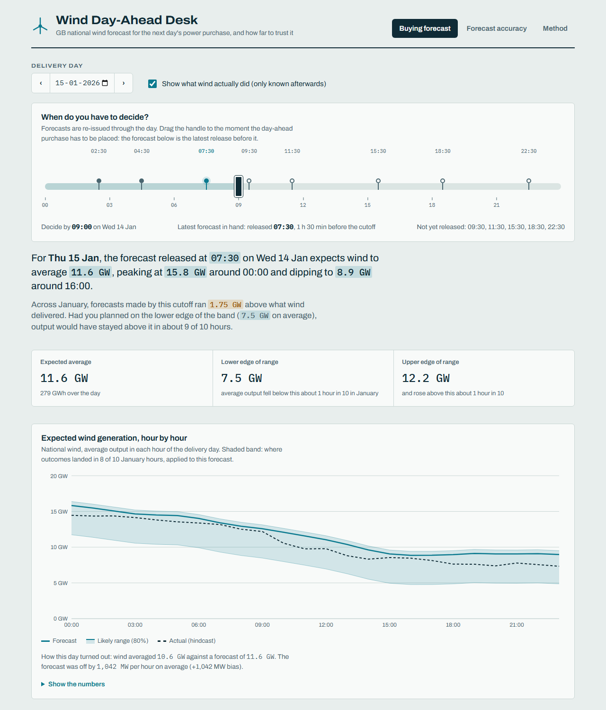
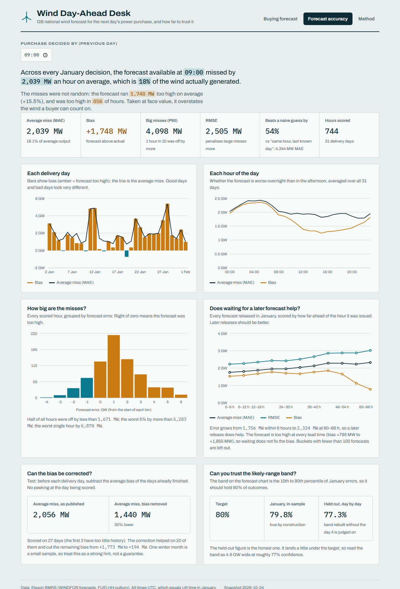
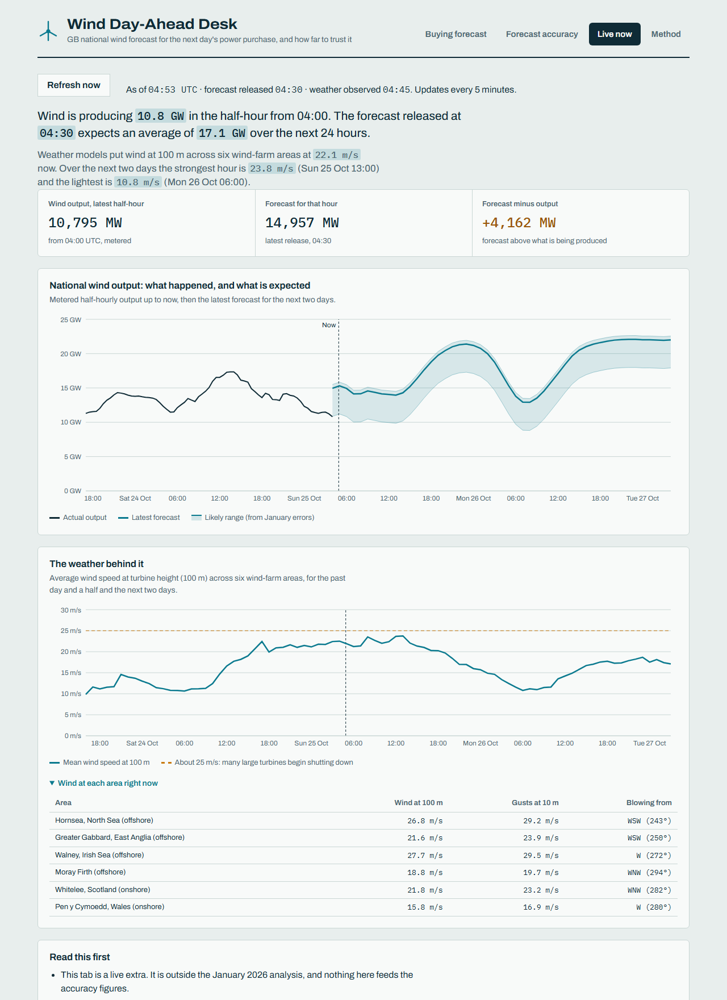

# Wind Day-Ahead Desk

A web app for a UK power buyer who has to decide, the day before delivery, how much electricity to buy in the day-ahead market. It shows the **latest national wind forecast available at the moment of the decision**, and it **quantifies how wrong that forecast has been** so the buyer can plan around the error instead of ignoring it.

Scope follows the brief: national wind only, Elexon BMRS data only, purchase decisions made in **January 2026** (delivery 2 Jan to 1 Feb).

| Buying forecast | Forecast accuracy | Live now |
|---|---|---|
|  |  |  |

**Live app:** _added after deployment_

## AI assistance disclosure

This project was built with the help of an AI coding assistant. It wrote most of the code, the tests and this README, working from the brief and iterating against the real data. Design choices, assumptions and limitations are written down below so they can be reviewed rather than taken on trust.

## Run it

**Docker (one container serves the API and the React app):**

```bash
docker compose up --build
# open http://localhost:8000
```

**Local development:**

```bash
# backend (Python 3.12) on :8000
cd backend
python -m venv .venv && source .venv/bin/activate      # Windows: .venv\Scripts\activate
pip install -r requirements-dev.txt
uvicorn app.main:app --reload

# frontend on :5173, proxies /api to :8000
cd frontend
npm ci
npm run dev
```

**Tests:** `cd backend && pytest` (26 tests, no network needed) and `cd frontend && npm test` (11 tests).
Interactive API docs are served at `/docs`.

## What the app does

1. **Buying forecast.** Pick a delivery day and drag the cutoff handle along a timeline of the previous day. Forecasts are re-released about eight times a day; the app uses the latest release at or before the cutoff for every hour, and says which one that is. The chart shows the hourly forecast, a likely-range band built from past errors, and (optionally) what wind actually did.
2. **Forecast accuracy.** For every January decision replayed the same way: average miss (MAE), bias, RMSE, big-miss percentiles, a comparison with a naive baseline, error by delivery day and by hour of day, the error distribution, how error changes with lead time, a walk-forward test of whether the bias can be corrected, and an honest check of whether the likely-range band holds on days it was not fitted on.
3. **Live now.** An extra beyond the January analysis. Today's national wind output and the latest forecast, with live weather (100 m wind speed at six wind-farm areas, from Open-Meteo) beside them. It refreshes every five minutes, and each source can fail without taking the other down. It never feeds the January figures.
4. **Method.** The definitions and caveats, in plain language.

## What the data says (cutoff 09:00 on the previous day)

Across 31 delivery days and 744 hours:

- The forecast misses by **2,039 MW** on average, **18%** of the wind actually generated (RMSE 2,505 MW; 1 hour in 10 is off by more than 4,098 MW).
- It is **biased high: +1,748 MW (+15.5%)**, and too high in **85%** of hours. This is the main finding. A buyer who takes the forecast at face value overstates the wind they can count on.
- It is genuinely useful: it beats a naive "same hour, last complete day" guess by **54%** (MAE 4,344 MW).
- Later releases are better: MAE is 1,756 MW for forecasts issued under 6 hours ahead and about 2,300 MW at 60+ hours. The bias persists at every lead time, so waiting does not remove it.
- The bias is correctable. Subtracting the average bias of already-finished days (walk-forward, no peeking) cuts MAE from 2,056 to 1,440 MW (**30% lower**) over the 27 days that have enough history, and helps on 20 of them.
- The 80% likely-range band covers 79.8% of January errors in-sample but **77.3% on held-out days** (the band is rebuilt without the day it is judged on). The app shows the held-out figure.

## How a decision is replayed

For delivery day D and cutoff C: the decision moment is D-1 at C, and for each hour of D the forecast used is the **latest `WINDFOR` release published at or before that moment**. Actual output (`FUELHH`, fuel type `WIND`) is used only to score it afterwards. A test checks that no forecast published after the cutoff is ever used, at both the function level and the API level.

## Assumptions and decisions

- **The cutoff is a parameter, default 09:00 on the previous day.** The real day-ahead gate closure is a fixed time that the brief does not give, so this is an assumption. The slider exists so the buyer can see how much it matters.
- **"Decisions made in January 2026"** means decisions on 1 to 31 January, for delivery on 2 January to 1 February.
- **Hourly vs half-hourly.** `WINDFOR` is hourly and `FUELHH` is half-hourly. Each forecast hour is scored against the mean of its two half-hours, and only if both are present.
- **Hindcasts are dropped.** Every release also contains a few hours that had already passed when it was published (for example a release at 02:30 includes hours back to 21:00 the evening before). Nobody can act on those, so rows with `publishTime >= startTime` are excluded.
- **Error = forecast minus actual.** Positive means the forecast was too high.
- **The likely-range band** is the 10th to 90th percentile of January errors applied to the forecast, so it is shifted down by the bias. It describes January, not the future.
- **Scope.** The brief limits the analysis to Elexon national wind data for January 2026. The Live tab goes beyond that on purpose and is labelled as such; the January pages are unchanged by it.
- **A snapshot is committed** (`backend/data/*.csv`, about 0.9 MB) so the deployed app never depends on Elexon being reachable. `python backend/scripts/fetch_data.py` re-downloads it.

## Limitations

- One winter month. Other seasons and weather regimes may behave differently, and the bias correction in particular needs more data before it can be trusted.
- The forecast runs consistently high against the metered wind series. The cause is not established here. One possibility is that the two series cover different sets of wind farms, but that is unverified.
- The lead-time chart pools different target hours in different buckets (because of how the 72-hour release windows are laid out), so small differences between neighbouring buckets should not be over-read.
- National totals only. The January analysis uses no weather, demand, price or interconnector data. The Live tab adds weather, but as context only: its wind index is an unweighted average over six hand-picked areas, not a model of output, and its likely-range band reuses January's errors.
- The same-hour persistence baseline is deliberately simple; a better baseline would make the forecast's margin look smaller.

## Repository layout

```
backend/
  app/
    main.py        FastAPI routes; also serves the React build when present
    analytics.py   decision replay, error metrics, band, bias-correction test (pure functions)
    store.py       loads the CSV snapshot; "latest forecast as of time T" lookups
    schemas.py     response models (these produce the OpenAPI docs at /docs)
    elexon.py      Elexon BMRS client (used by the fetch script)
    live.py        the Live tab: today's Elexon data and Open-Meteo weather, cached for 5 minutes
  scripts/fetch_data.py   refreshes backend/data from Elexon
  data/                   actuals.csv, forecasts.csv, FETCHED_AT.txt
  tests/                  analytics unit tests and API contract tests
frontend/
  src/
    App.tsx, DecisionView.tsx, AccuracyView.tsx, MethodView.tsx
    PublicationLadder.tsx   the cutoff timeline
    LiveView.tsx            the Live tab
    api.ts, useApi.ts       typed API client and a small fetch hook
    format.ts, ui.tsx       formatting helpers, shared components
Dockerfile, docker-compose.yml   single image: builds React, then serves everything from FastAPI
vercel.json                      Vercel Services layout (static frontend + FastAPI)
docs/                            screenshots used above
```

## API

| Endpoint | Purpose |
|---|---|
| `GET /api/meta` | coverage, release times, data counts, notes |
| `GET /api/publications?delivery_date=` | releases on the decision day, plus the last release before it |
| `GET /api/decision?delivery_date=&cutoff=HH:MM` | the forecast in hand at the cutoff, band, summary, hindcast |
| `GET /api/accuracy?cutoff=HH:MM` | metrics, baseline, band reliability, bias correction, breakdowns |
| `GET /api/accuracy/horizon?bucket_h=6` | error against lead time over all releases |
| `GET /api/live` | today's forecast and output plus live weather; a failing source is reported in `errors` instead of failing the call |
| `GET /api/health` | liveness |

Bad input gets a clear error: dates outside the January decision window and malformed cutoffs return 422, and a cutoff earlier than the first available release returns 404 with an explanation.
